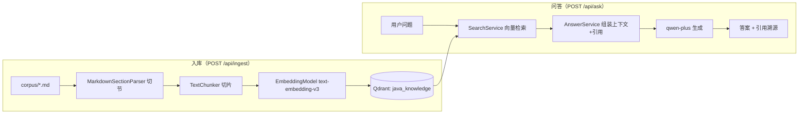

# M2 · basic-rag（阶段说明 + 学习计划）

> 【迭代内容：相对 M1 新增 RAG 管道】在 M1 的"环境就绪骨架"之上，新增完整的最小闭环：
> **语料解析 → 切片 → 百炼 embedding → Qdrant 入库 → 相似度检索 → 带引用溯源的生成**，并提供网页问答页。

## 一、阶段性学习目标
- 跑通 RAG 最小闭环，理解每一步"为什么必须存在"。
- 掌握 embedding 维度与向量库 collection 的关系、切片的幂等策略。
- 理解"检索增强"如何约束大模型不编造（只依据资料回答 + 引用标注）。

## 二、实战内容
1. **解析**：`MarkdownSectionParser` 按标题把 Markdown 切成"节"（heading + 正文）。
2. **切片**：`TextChunker` 按段落边界断开，带 overlap，避免语义拦腰截断。
3. **入库**：`IngestionService` 遍历 `corpus/` 的 .md → embedding（`text-embedding-v3`）→ 写入 Qdrant；
   切片 ID 由（相对路径+标题+序号）确定性生成 → **重复入库覆盖同 ID，天然幂等**；
   collection 不存在时按当前模型维度自动创建（余弦相似度）。
4. **检索**：`SearchService` 用 `VectorStore.similaritySearch` 取 top-4（阈值 0.45）。
5. **生成**：`AnswerService` 把片段拼成带编号上下文，约束模型"只依据资料回答 + [1][2] 标注引用 + 不足时明说"。
6. **网页**：`/` 问答页（提问 + 一键入库 + 引用溯源展示），`/status` 环境状态页（沿用 M1）。
7. **REST**：`POST /api/ask`、`POST /api/ingest`。
8. 示例语料 4 篇（Spring 循环依赖 / MySQL 索引 / 缓存一致性 / 接口幂等）。

## 三、当前架构与技术栈
- Java 17 + Spring Boot 3.4.5 + Thymeleaf（纯服务端渲染，无前端构建）
- Spring AI **1.0.0 GA**（BOM 管理；注意 GA 后坐标改名：Qdrant starter 为 `spring-ai-starter-vector-store-qdrant`）
- 百炼：`com.alibaba.cloud.ai:spring-ai-alibaba-starter-dashscope:1.0.0.2`（chat=qwen-plus，embedding=text-embedding-v3）
- 本地向量库：Qdrant（Docker，collection=`java_knowledge`）。⚠️ 端口注意：**应用经 gRPC 连 6334**（Spring AI 的 Qdrant 客户端走 gRPC/HTTP2），**6333 是 REST 端口**仅用于 `/status` 状态页探活；两者不要混用，否则报 `http2 exception / First received frame was not SETTINGS`。
- 相对 M1 的差异：引入 Spring AI 依赖（M1 已移除预留依赖，避免版本冲突）；首页从状态页变为问答页。

### 3.1 接口列表（M2 对外契约）

### 网页入口
| 路径 | 方法 | 说明 |
|------|------|------|
| `/` | GET | 问答页：提问 + 一键入库 + 引用溯源展示 |
| `/status` | GET | 环境状态自检页（Qdrant 可达 + Key 已配置 → READY） |

### REST API
| 路径 | 方法 | 入参 | 返回 |
|------|------|------|------|
| `/api/ingest` | POST | 无 | `{ "files":4, "chunks":N, "message":"..." }`：触发语料入库（解析→切片→embedding→写 Qdrant） |
| `/api/ask` | POST | JSON `{ "question": "..." }` | `Answer { answer, citations:[ {index, source, heading, score} ] }` |

入参示例：
```bash
curl -X POST localhost:8080/api/ask -H 'Content-Type: application/json' \
     -d '{"question":"Spring 是怎么解决循环依赖的？"}'
```

### 关键类职责一览（数据流对应）
| 类 | 角色 | 在流程中的位置 |
|----|------|----------------|
| `MarkdownSectionParser` | 按标题把文档切成"节"（heading + 正文） | 入库·解析 |
| `TextChunker` | 长节按段落边界切片（带 overlap） | 入库·切片 |
| `IngestionService` | 编排入库全链路 + collection 初始化 + 幂等 ID | 入库·编排 |
| `EmbeddingModel`(百炼) | `text-embedding-v3` 文本向量化（由 `VectorStore.add` 内部调用） | 入库·向量化 |
| `VectorStore`(Qdrant) | 写入/相似度检索向量库（collection=`java_knowledge`） | 入库+问答·存储 |
| `SearchService` | 问题向量化 + top-k 相似度检索 | 问答·检索 |
| `AnswerService` | 拼带编号上下文 + 调用 qwen-plus 生成 + 引用溯源 | 问答·生成 |
| `ApiController` | 暴露 `/api/ask`、`/api/ingest` | 入口 |
| `PageController` | 渲染问答页 / 状态页 | 入口 |

### 3.2 数据流与流程图（M2 最小闭环）

**文字流程**
1. **入库（离线/按需）**：`POST /api/ingest` → `IngestionService` 遍历 `corpus/` → `MarkdownSectionParser` 切节 → `TextChunker` 切片 → `EmbeddingModel(text-embedding-v3)` 向量化 → `VectorStore` 写 Qdrant（collection=`java_knowledge`）。
2. **问答（在线）**：`POST /api/ask` → `SearchService` 把问题向量化 → Qdrant 相似度检索 top-4 → `AnswerService` 组装带编号上下文 + 调用 `qwen-plus` 生成 → 返回答案与引用。



> 说明：`EmbeddingModel` 与 `ChatModel` 由 Spring AI 的百炼自动装配提供（依赖 `DASHSCOPE_API_KEY`）；`VectorStore` 由 Qdrant 自动装配提供（依赖本地 Qdrant 的 gRPC 端口 6334）。两者解耦，M3 起可单独替换检索/生成组件。

## 四、企业级迭代与替换指引
- 解析/切片：本期按标题+段落 → 企业：接 Tika/自研解析器、语义切片、表格/代码特殊处理。
- embedding 每次重算 → 企业：增量入库 + 内容 hash 去重 + 批量 embedding 降成本。
- 单一 collection → 企业：多租户隔离（按租户/权限分 collection 或 payload 过滤）。
- 朴素相似度检索 → 企业：混合检索 + Rerank + 权限过滤（M3 方向）。
- 网页明文调用 → 企业：网关鉴权、限流、审计日志。

## 五、前置准备（安装·账号·环境变量）
- 沿用 M1：Docker + Qdrant（若 M1 的 `rag-qdrant` 已在跑可直接复用）、JDK 17。
- 百炼 API Key 已配置（M1 已完成）；M2 起真正调用 embedding 与 chat，Key 必须有效。
- IDEA 运行配置环境变量：`DASHSCOPE_API_KEY`。

### 排错速查
- **`HTTP 403 AllocationQuota.FreeTierOnly`（Free quota exhausted）**：百炼**免费额度用完**。这不是代码问题——Key 有效（否则是 401）。去百炼/DashScope 控制台**关闭「仅使用免费额度」并开启按量付费**（需充值），或等额度按月重置。开启按量付费不需要改 Base URL（那是给 OpenAI/Anthropic 兼容 SDK 用的）。
- **`HTTP 400 code:InvalidParameter message:url error, please check url`**（只在**生成/chat** 时报，embedding 不报）：**根因是工作空间的 chat 模型（如 `qwen3.8-27b`）只暴露在百炼 OpenAI 兼容端点 `/compatible-mode/v1/chat/completions`，而 spring-ai-alibaba 默认的 `DashScopeChatModel` 走原生接口 `/api/v1/services/aigc/text-generation/generation`，该接口不认工作空间 chat 模型**。排查要点（已用 curl 实测 + 反编译 jar 确认）：
  1. embedding 模型（如 `qwen3.7-text-embedding-flash`）在**原生端点**可用 → `spring.ai.dashscope.base-url` 用工作空间网关**根地址**（不要带 `/compatible-mode/v1`）。
  2. chat 模型只能用**兼容端点** → 本项目改用 Spring AI 通用 OpenAI 客户端（`spring-ai-starter-model-openai`）对接 `spring.ai.openai.base-url: https://ws-xxxx.cn-beijing.maas.aliyuncs.com/compatible-mode`（**注意：末尾不要带 `/v1`**——`OpenAiApi` 默认 `completionsPath=/v1/chat/completions` 会自己拼上去，带 `/v1` 会变成 `.../compatible-mode/v1/v1/chat/completions` → 404），由 `RagChatConfig` 装配为 `@Primary` ChatClient。
  3. 验证模型名：先 `curl https://ws-xxxx...maas.aliyuncs.com/compatible-mode/v1/models` 拿到工作空间模型清单，再用兼容端点试对话，确认模型 ID 正确。
- **`Qdrant client version x incompatible with server version y`**：仅兼容性 WARN（次版本差 >1），不影响功能；gRPC 已正常连接。想消除可在 Qdrant 客户端设 `checkCompatibility=false`。
- **`http2 exception / First received frame was not SETTINGS`**：连错端口了。Spring AI 的 Qdrant 客户端走 **gRPC 6334**，不要把 `spring.ai.vectorstore.qdrant.port` 配成 REST 的 6333。

## 六、部署与访问（单机）
```bash
cd stages/M2-basic-rag
# Qdrant 若已在跑（M1 起过）可跳过；否则：
docker compose up -d
export DASHSCOPE_API_KEY=你的Key
mvn spring-boot:run
```
- 网页访问：http://localhost:8080 （问答页）
  1. 点 **（重新）入库语料** → 提示"文件 4 个，切片 N 个"
  2. 输入问题（如"Spring 怎么解决循环依赖？"）→ 提问 → 得到带 [1][2] 引用的答案 + 来源列表
- API：`POST /api/ingest`、`POST /api/ask`（body: `{"question":"..."}`）
- 状态页：http://localhost:8080/status
- 验证标准：入库成功 + 问答能命中语料并给出引用 → M2 完成 ✅
