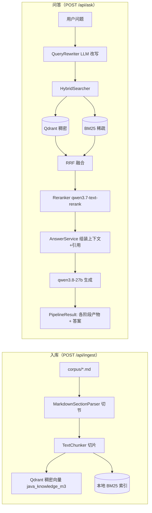

# M3 · rag-pipeline（阶段说明 + 学习计划）

> 【迭代内容：相对 M2 新增"生产级检索管道"】在 M2 的单路稠密 RAG 之上，把"检索"升级为**混合检索 + Query 改写 + Rerank + 分阶段可视化**的管道：
> **原始问题 → (LLM 改写) → 混合检索(稠密 Qdrant + 本地 BM25 稀疏, RRF 融合) → 百炼 Rerank → 带引用溯源的生成**，并把每一阶段的产物都暴露给前端页面，便于理解管道与调试。

## 一、阶段性学习目标
- 理解"单路稠密检索的天花板"（语义相关但关键词不匹配会漏召回），以及混合检索如何补上稀疏这一路。
- 理解 RRF 融合为何能把"量纲不同"的两路分数（余弦相似度 vs BM25 得分）无损合并。
- 理解 Query 改写 / Rerank 各自解决什么问题，以及它们**何时会帮倒忙**（详见第五节经验沉淀）。
- 建立"检索可观测"意识：把每一阶段的命中与分数打到日志/页面，而不是只看最终答案。

## 二、实战内容
1. **解析 / 切片**：沿用 M2 的 `MarkdownSectionParser`（按标题切"节"）+ `TextChunker`（按段落边界切，带 overlap）。
2. **本地 BM25 稀疏检索（新增，零外部依赖）**：`Bm25Index` 在入库时逐切片建倒排索引，查询时按 BM25 公式召回 top-K。工作空间**没有稀疏向量模型**，故稀疏走本地实现，契合"各阶段零新基建"的定位。
3. **混合检索 + RRF 融合（新增）**：`HybridSearcher` 用一份查询**并行**跑稠密（Qdrant 向量）与稀疏（BM25），再用 RRF（Reciprocal Rank Fusion）按名次融合。
4. **Query 改写（新增）**：`QueryRewriter` 用 LLM 把用户问题改写成更利于检索的查询。⚠️ 当前实现把改写结果同时用于稠密、稀疏、Rerank 三路——这是有意的简化，但存在"意图漂移"风险，见第五节。
5. **Rerank（新增）**：`Reranker` 对融合后的前 N 条候选调用百炼 `qwen3.7-text-rerank` 二次精排，取精排结果送生成；失败自动降级为融合顺序。
6. **分阶段可视化问答页（新增）**：`ask.html` 把 改写 → 稠密命中 → 稀疏命中 → 融合 → 重排 → 最终答案 全部渲染出来。
7. **REST**：`POST /api/ask` 返回完整 `PipelineResult`（含各阶段中间产物）；`POST /api/ingest` 触发入库（稠密 + 稀疏同步构建）。
8. 示例语料 4 篇（Spring 循环依赖 / MySQL 索引 / 缓存一致性 / 接口幂等），入库约 18 切片。

## 三、当前架构与技术栈
- Java 17 + Spring Boot 3.4.5 + Thymeleaf（纯服务端渲染，无前端构建）+ Spring AI **1.0.0 GA**。
- 本地向量库 Qdrant（Docker，collection=`java_knowledge_m3`，**应用经 gRPC 连 6334**；**6333 是 REST 端口**仅用于 `/status` 探活，勿混用）。
- 百炼模型（均在你的工作空间网关下）：
  - embedding：`qwen3.7-text-embedding-flash`，走 `spring.ai.dashscope` **原生 API**（base-url = 网关根地址）。
  - chat：`qwen3.8-27b`，走 `spring.ai.openai` **OpenAI 兼容端点**（`base-url` 只到 `/compatible-mode`，**末尾不带 `/v1`**——`OpenAiApi` 默认 `completionsPath=/v1/chat/completions` 会自己拼）。
  - rerank：`qwen3.7-text-rerank`，走百炼**原生 rerank 端点** `…/api/v1/services/rerank/text-rerank/text-rerank`。

### 3.1 接口列表

### 网页入口
| 路径 | 方法 | 说明 |
|------|------|------|
| `/` | GET | 增强问答页：分阶段可视化（改写/稠密/稀疏/融合/重排/答案）+ 一键入库 |
| `/status` | GET | 环境状态自检页（Qdrant 可达 + Key 已配置 → READY） |

### REST API
| 路径 | 方法 | 入参 | 返回 |
|------|------|------|------|
| `/api/ingest` | POST | 无 | `{ "files":4, "chunks":18, "message":"..." }`：触发语料入库（稠密+稀疏同步） |
| `/api/ask` | POST | JSON `{ "question": "..." }` | `PipelineResult { originalQuery, rewrittenQuery, denseHits[], sparseHits[], fusedHits[], rerankedHits[], answer, citations[] }` |

入参示例：
```bash
curl -X POST localhost:8081/api/ask -H 'Content-Type: application/json' \
     -d '{"question":"Spring 是怎么解决循环依赖的？"}'
```

### 关键类职责一览（数据流对应）
| 类 | 角色 | 在流程中的位置 |
|----|------|----------------|
| `MarkdownSectionParser` / `TextChunker` | 按标题切节、按段落切片（带 overlap） | 入库·解析 |
| `IngestionService` | 编排入库全链路 + Qdrant 自动建表 + 确定性幂等 ID；**同时写入 BM25** | 入库·编排 |
| `Bm25Index` | 本地倒排索引（BM25 打分），零外部依赖，常驻内存 | 入库+问答·稀疏检索 |
| `VectorStore`(Qdrant) | 写入/相似度检索向量库（collection=`java_knowledge_m3`） | 入库+问答·稠密检索 |
| `QueryRewriter` | LLM 改写用户问题（复用 `@Primary` ChatClient=qwen3.8-27b） | 问答·改写 |
| `HybridSearcher` | 稠密+稀疏并行召回 + RRF 融合 | 问答·混合检索 |
| `Reranker` | 调百炼 `qwen3.7-text-rerank` 对融合候选精排（失败降级） | 问答·重排 |
| `AnswerService` | 仅依据给定命中拼上下文 + 调用 chat 生成 + 引用溯源 | 问答·生成 |
| `PipelineService` | 串联 改写→混合检索→重排→生成，产出 `PipelineResult` | 问答·编排 |
| `ApiController` / `PageController` | 暴露 `/api/ask`、`/api/ingest` 与页面 | 入口 |

### 3.2 数据流与流程图

**文字流程**
1. **入库（离线/按需）**：`POST /api/ingest` → 遍历 `corpus/` → 切节切片 → 同批切片**同时**写 Qdrant（稠密）与本地 BM25（稀疏）；切片 ID 确定性生成 → 幂等。
2. **问答（在线）**：`POST /api/ask` → `QueryRewriter` 改写 → `HybridSearcher` 并行稠密+稀疏并按 RRF 融合 → `Reranker` 对融合前 N 条精排 → `AnswerService` 依据精排结果生成带引用答案。



> 说明：上图"改写→混合检索→重排"是逻辑链路。需特别注意——**当前实现里 `QueryRewriter` 的改写结果被同一份用于稠密、稀疏、Rerank 三路**（见第五节）。这是简化的实现选择，并非唯一正确做法。

## 四、企业级迭代与替换指引
- **本地 BM25 → 稀疏向量 / Elasticsearch**：语料量大、需要持久化/分布式时，把 `Bm25Index` 换成云端稀疏向量或 ES 的倒排+向量混合；RRF 融合逻辑可不变。
- **Rerank 模型**：可换更轻量或更强的 rerank 模型，或引入"检索后截断 + 重排"的多级排序（召回多、精排少）。
- **分阶段可视化 = 可观测性雏形**：生产环境应把各阶段命中/分数上报到监控（如 OpenTelemetry），而非仅页面展示。
- **改写策略**：当前是"关键词扩展"，可升级为 HyDE（用 LLM 生成假设答案再检索）、或多查询并行检索（multi-query）。**但务必遵循"双查询"原则（见第五节）**。

## 五、关键经验沉淀：Query 改写的「意图漂移」陷阱（重要）

这是 M3 实操中暴露出的**核心坑**，务必理解。

### 现象
原问题：`Spring 是怎么解决循环依赖的？`
改写后：`Spring 循环依赖 解决方案 Spring Bean 循环引用 三级缓存 二级缓存 AOP 代理 早期引用 getEarlyBeanReference singletonFactories earlySingletonObjects currentlyInCreation 构造器循环依赖 字段注入 setter注入 自依赖`

——改写把**原问题里没有的内容**（"三级缓存""AOP 代理"等）塞了进来。

### 为什么（根因）
`QueryRewriter` 的 prompt 明确要求 LLM"**补充同义词/技术名词**、把多个子查询用空格连起来"。于是 LLM 基于自身知识，把"Spring 解决循环依赖的答案词汇"当成相关词补了进去。这些词恰恰都出现在 `circular-dependency.md` 里，所以**对稀疏检索（BM25）反而是有益的**（增加词面重叠、提升召回）。

### 但它为什么"严重"
这是典型的**查询扩展（query expansion）副作用——用 LLM 猜答案的词汇来扩召回**，代价是：
1. **偏离用户原始意图**：你只问"循环依赖"，改写却替你假设了"答案一定是三级缓存机制"。若你其实想问"怎么排查循环依赖报错"，扩展反而把你带偏。
2. **污染稠密 + 重排这两条腿**：关键词汤喂给语义向量和 rerank（其 instruct 是"given a web search query, retrieve passages that answer the query"），反而比你的自然语言问句更差；而且扩展词里常混入语料中**根本不存在**的词（如 `currentlyInCreation`、`自依赖`），对 BM25 是纯噪声、对 rerank 是干扰。
3. **不可复现**：`ChatClient` 未设 `temperature`，默认随机 → 每次改写结果不同。

> 之所以之前端到端"答对了"，是因为语料小、扩展词恰好命中——这是侥幸，不是设计正确。

### 正确做法：双查询（Dual-Query，混合检索标准范式）
- **稠密检索 + Rerank → 用你的原始自然语言问题**（保意图、语义最准、重排最稳）；
- **只有稀疏检索（BM25）→ 用扩展后的关键词**（补同义词/术语，专治关键词不匹配）；
- RRF 再把两路排名融合，各取所长；
- 改写 `temperature=0`，保证可复现；prompt 去掉"用空格连起来"，改为"输出用于关键词召回的术语/同义词列表"。

> 当前 M3 代码**尚未采用双查询**（改写结果被三路共用）。本节作为经验沉淀记录正确范式，后续迭代（或你练习时）应按此改造 `QueryRewriter` + `HybridSearcher` + `PipelineService`：让 `HybridSearcher` 同时接收 `originalQuery`（稠密/重排用）与 `expandedQuery`（稀疏用）。

## 六、前置准备（安装·账号·环境变量）
- 沿用 M1：Docker + Qdrant（若已在跑可直接复用）、JDK 17。
- 百炼 API Key 已配置；M3 真正调用 embedding / chat / rerank，Key 必须有效。
- IDEA 运行配置环境变量：`DASHSCOPE_API_KEY`。

### 排错速查
- **`HTTP 400 url error`（仅 chat/rerank 时报）**：chat 必须走 OpenAI 兼容端点（`spring.ai.openai.base-url` 到 `/compatible-mode`，**末尾不要带 `/v1`**）；rerank 必须走百炼原生 rerank 端点 `/api/v1/services/rerank/text-rerank/text-rerank`。
- **rerank 调用无结果/抛异常**：检查 `rag.rerank.url` 是否拼错路径（不是 `/v1/rerank`、也不是 `/services/rerank`）。响应里用的是 `output.results[].index`（对应输入下标）与 `relevance_score`（snake_case）。
- **改写结果"漂"得离谱 / 每次不同**：见第五节——这是查询扩展的固有风险 + 未设 temperature；生产应改双查询 + `temperature=0`。
- **`http2 exception / First received frame was not SETTINGS`**：连错端口。Qdrant 应用走 **gRPC 6334**，不要把 `spring.ai.vectorstore.qdrant.port` 配成 REST 的 6333。
- **collection 维度不匹配报错**：换 embedding 模型后维度变化，点一次「入库语料」让 `ensureCollection` 按新维度重建 collection 即可。
- **查询返回空 / "没检索到"**：先确认已点过「入库语料」（`/api/ingest`）；再看 `similarity-threshold`（现 0.30）是否过严，适当调高 `top-k` 或降低阈值。

## 七、部署与访问（单机）
```bash
cd stages/M3-rag-pipeline
# Qdrant 若已在跑（M1/M2 起过）可跳过；否则：
docker compose up -d
export DASHSCOPE_API_KEY=你的Key
mvn spring-boot:run
```
- 网页访问：http://localhost:8081 （增强问答页，分阶段可视化）
  1. 点 **（重新）入库语料** → 提示"文件 4 个，切片 18 个"
  2. 输入问题（如"Spring 怎么解决循环依赖？"）→ 提问 → 页面分六段展示：改写结果 / 稠密命中 / 稀疏命中 / RRF 融合 / Rerank 精排 / 最终答案+引用
- API：`POST /api/ingest`、`POST /api/ask`（body: `{"question":"..."}`）
- 状态页：http://localhost:8081/status
- 验证标准：入库成功 + 六段可视化均合理 + 答案带 `[n]` 引用并命中正确切片 → M3 完成 ✅

### 端到端验证记录（本机实测）
- 入库：`{"files":4,"chunks":18}`（Qdrant 与本地 BM25 同步建好）。
- 提问"Spring 是怎么解决循环依赖的？"：Rerank 把相关切片提到 `0.99/0.89/0.83/0.82/0.74`，无关切片（redis-cache 一致性）被打到 `0.014` → 重排确实把无关内容压到了最后，最终答案准确讲述"三级缓存 + 提前曝光 + 为何需要三级（AOP）+ 构造器/prototype 无解"。
- 观察建议：对照页面六段，确认"改写是否引入你没问的内容"（第五节现象），这正是理解 RAG 检索质量的关键练习。
