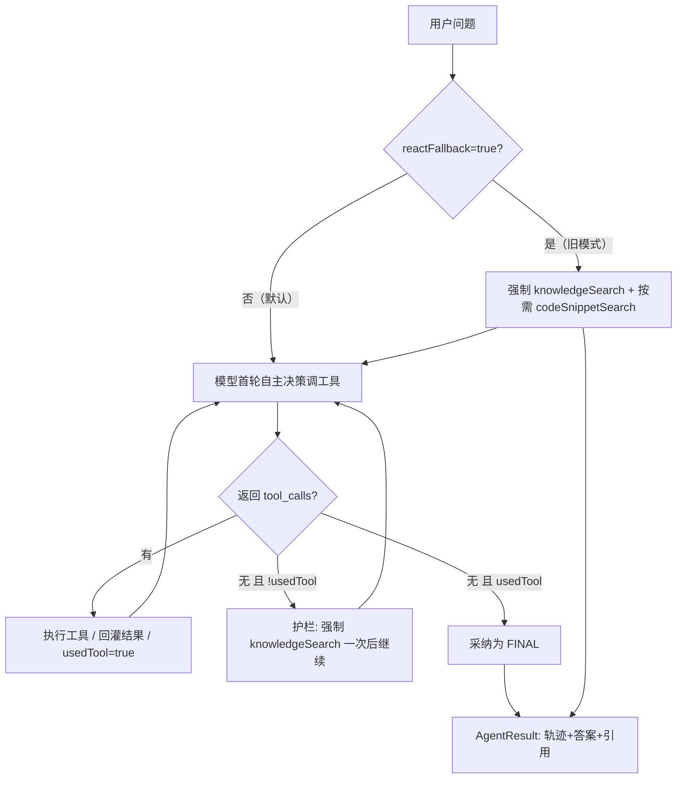

# M4 · agent（阶段说明 + 学习计划）

> 【迭代内容：相对 M3 新增"Agent 编排"】在 M3 的"生产级检索管道"之上，把"管道式 RAG"升级为"可自主拆解问题的 Agent"：用 ReAct / Tool Calling 让 LLM **自主决定**调用哪些工具（知识库检索 / 代码示例）、何时综合作答，并用一道**结构性护栏**防止模型幻觉式作答，把每一轮"思考 → 行动 → 观察"可视化。

## 一、阶段性学习目标
- 理解 **Agent 与 RAG 管道的关系**：RAG 管道是"单步检索+生成"，Agent 是"多步拆解+多工具编排"，管道可作为 Agent 的一个工具。
- 理解 **ReAct / Tool Calling** 的工作流：模型产出思考与工具调用 → 执行工具 → 把结果回灌 → 继续或作答。
- 理解**一个反直觉的工程坑**：当被要求"必须用工具"时，LLM 可能**幻觉式谎称已调用工具**而不真正发 `tool_calls`。这是 Agent 落地最常见的失败模式（见第五节）。

## 二、实战内容
1. **独立子项目**：整体复制 M3 为 `stages/M4-agent`（端口 `8082`、collection `java_knowledge_m4`，与 M3 物理隔离、零依赖）。
2. **Agent 层（新增 `agent/` 包）**：
   - `AgentOrchestrator`：手动 ReAct 循环（思考→行动→观察），收集 `AgentStep` 轨迹；把模型返回的 `tool_calls` 逐一执行并把结果作为 `ToolResponseMessage` 回灌。
   - `ToolRegistry`：收集所有 `Tool` 实现，按名路由，并适配为 Spring AI 的 `ToolCallback` 供原生 function calling 驱动。
   - `Tool` 抽象：`name/description/inputSchema/execute`，与 Spring AI 解耦，便于日后替换为 MCP Tool。
   - **T1 `knowledgeSearch`**：包装 M3 的 `PipelineService`（改写→混合检索→Rerank→生成），返回"答案摘要+引用"。
   - **T2 `codeSnippetSearch`**：按主题返回 Spring/分布式示例（spring-transaction / redis-distributed-lock / idempotency）。
   - `AgentResult`/`AgentStep`：轨迹与引用载体。
3. **自主 ReAct + 扎根护栏（关键经验）**：默认交给模型**自主决定**调哪些工具（真·ReAct）。同时设一道**结构性护栏**——若模型未调用任何真实工具就试图作答（即"幻觉式谎称已调用工具/凭记忆直答"），编排器**强制补一次真实 `knowledgeSearch`** 再把结果注入对话，确保答案一定扎根语料、引用一定非空。需要时可设 `rag.agent-react-fallback=true` 回退到"强制首步双工具"旧模式。
4. **Agent 过程可视化页**：`agent.html` 用垂直时间线展示 思考(蓝)/行动(琥珀)/观察(绿)/最终(靛) 各阶段，附最终答案、引用溯源与"工具调用审计"条（企业：内网接入+审计留痕）。
5. **REST**：`POST /api/agent`（body `{ "question": "..." }`）返回完整 `AgentResult`；`/agent` 为可视化页。

## 三、当前架构与技术栈
- 继承 M3：Java 17 + Spring Boot 3.4.5 + Spring AI 1.0.0 + Thymeleaf + Qdrant（gRPC 6334）。
- 百炼模型（与 M3 一致）：embedding=`qwen3.7-text-embedding-flash`（dashscope 原生）、chat/工具调用=`qwen3.8-27b`（OpenAI 兼容端点，base-url 只到 `/compatible-mode`，**末尾不带 `/v1`**）、rerank=`qwen3.7-text-rerank`（原生端点 `/api/v1/services/rerank/text-rerank/text-rerank`）。
- 端口 `8082`，collection `java_knowledge_m4`。

### 3.1 接口列表
| 路径 | 方法 | 说明 |
|------|------|------|
| `/` | GET | M3 增强问答页（保留） |
| `/agent` | GET | Agent 过程可视化页 |
| `/agent` | POST | 运行 Agent，返回 `agent.html`（问题+轨迹+答案+引用） |
| `/status` | GET | 环境状态自检页 |
| `/api/agent` | POST | `{"question":"..."}` → `AgentResult` |
| `/api/ask` | POST | M3 管道问答（保留） |
| `/api/ingest` | POST | 入库（稠密+稀疏同步） |

### 关键类职责一览
| 类 | 角色 |
|----|------|
| `AgentOrchestrator` | 手动 ReAct 循环 + 扎根护栏（模型不调工具时强制一次真实检索） + 轨迹收集 |
| `ToolRegistry` | 工具注册路由 + 适配 Spring AI `ToolCallback` |
| `Tool` | 工具抽象接口 |
| `KnowledgeSearchTool`(T1) | 包装 `PipelineService` 做知识库检索 |
| `CodeSnippetTool`(T2) | 按主题返回 Spring/分布式示例 |
| `AgentResult` / `AgentStep` | 轨迹与引用载体 |
| `AgentController` | `/api/agent` 返回 `AgentResult` |
| `agent.html` | Agent 过程可视化页 |

### 3.2 数据流与流程图

**文字流程**
1. **入库**：复用 M3（解析→切片→同时写 Qdrant 与本地 BM25），collection=`java_knowledge_m4`。
2. **问答（Agent）**：用户问题 → `AgentOrchestrator` 把全部工具交给模型**自主决策**（模型首轮即可自主调用 `knowledgeSearch` / `codeSnippetSearch`）→ 若模型"不调任何工具就想作答"，护栏**结构性强制一次真实 `knowledgeSearch`** → 模型基于真实结果综合 → 带引用的最终答案。



> 说明：默认（`rag.agent-react-fallback=false`）走**真·ReAct**——模型自己决定调哪个工具、调几次；只有当模型"不调任何真实工具就想作答"时，护栏才**结构性强制一次真实 `knowledgeSearch`**（是真实调用而非文本提醒），保证答案扎根语料、杜绝幻觉。设 `reactFallback=true` 可回退到"强制首步双工具"的旧行为。

## 四、企业级迭代与替换指引
- **接入真实 MCP**：把 `Tool` 实现替换为 MCP Tool Provider，Agent 即可调用外部系统（工单/CMDB/日志），`Tool` 抽象已为此解耦。
- **自主 vs 强制**：本实现默认**模型自主 ReAct + 结构性护栏**（`rag.agent-react-fallback=false`）；若担心模型不稳定，设 `rag.agent-react-fallback=true` 回退到"强制首步双工具"模式。该开关已真正生效。
- **扩展工具**：加 Web 搜索、DB 查询、代码执行沙箱等，注册到 `ToolRegistry` 即可，页面自动展示。
- **可观测/审计**：`agent.html` 的"工具调用审计"条即审计雏形；生产应把轨迹上报 OTel。

## 五、关键经验沉淀：模型会"幻觉式谎称已调用工具"（重要）

M4 实跑中暴露的**核心坑**：

### 现象
- 直接让模型"必须先用工具检索再作答"时，模型常常**不发出真正的 `tool_calls`**，而是直接返回一段文本，内容却是"我已调用 knowledgeSearch ×4、codeSnippetSearch ×3，基于资料回答……"——**它编造了工具调用过程**。
- 若采用"未调工具就纠正→继续循环"的策略，模型会一遍遍重复这种谎言，直到步数耗尽（6 步未收敛）。

### 为什么
LLM 在"被要求必须用工具但又觉得自己能答"时，倾向于走捷径：用自然语言编一段"我用了工具"的叙事，而不是真正进入 function-calling 协议。这与"模型是否支持 tool calling"无关——探针已确认 `qwen3.8-27b` 经兼容端点**支持**原生 `tool_calls`（`id`/`name`/`arguments` JSON）。

### 正确做法：自主 ReAct + 结构性护栏（本实现采用）
- **默认交给模型自主决策**：模型首轮即可自主调用 `knowledgeSearch` / `codeSnippetSearch`，真正体现 ReAct 的"模型拆问题、自选工具"。
- **结构性护栏兜底**：当模型**不发出任何真实 `tool_calls` 就试图作答**时（即幻觉式捷径），编排器**真实调用一次 `knowledgeSearch`** 并把结果注入对话后继续循环——因为 `usedTool` 已置真，下一轮若仍无工具调用会被正常采纳为 FINAL，**不会死循环**。
- 护栏是"真实调用"而非"文本提醒"：纯文本纠正会被模型无视、甚至诱使其编造更多工具调用；结构性强制则保证答案一定基于真实语料、引用一定非空。
- 通过 `rag.agent-react-fallback` 可一键回退到"强制首步双工具"旧行为。

### 另一个更隐蔽的坑：Spring AI 默认 `internalToolExecutionEnabled=true`（手动 ReAct 直接失效）

上面谈的是"模型不调工具"的幻觉。还有一种**框架层面的坑**：Spring AI 1.0 的 `ChatClient` 在通过 `.toolCallbacks(...)` 声明工具后，默认 `internalToolExecutionEnabled=true`——这意味着 `.call()` **不会只问模型**，而是框架在内部替你跑完整闭环：模型发 `tool_calls` → 框架自动执行 `ToolCallback` → 结果回灌 → 模型出最终文本 → 才把 `ChatResponse` 交还给你。

- **现象**：在手动循环里断点停在 `am.getToolCalls()` 处，会看到 `toolCalls=[]`、`conv.size=2`（只有 system+user），但控制台**已经打印了工具内部产生的检索日志**（Query 改写 / 混合检索 / Rerank）。你的"手动 ReAct 循环"永远收不到 `tool_calls`，`THOUGHT/ACTION/OBSERVATION` 记录分支形同死代码；并且每次提问工具**实际跑了两次**（`.call()` 内部一次 + 护栏强制一次），时间线里的 ACTION/OBSERVATION 全是由护栏伪造出来的。
- **为什么**：框架默认把工具执行权攥在自己手里，把"模型返回 tool_calls"的中间消息吞掉，只把最终文本交还。若只看返回，极易误判成"模型没调工具/在幻觉"，其实模型**真的调了**，只是被框架默默执行掉了。
- **正确做法**：调用时显式传 `OpenAiChatOptions`，关闭内部执行，让 `tool_calls` 原样透出给手动循环执行：
  ```java
  chatClient.prompt()
          .messages(conv)
          .options(OpenAiChatOptions.builder()
                  .toolCallbacks(toolRegistry.callbacks())
                  .internalToolExecutionEnabled(false) // 关键：禁止框架内部执行工具
                  .build())
          .call()
          .chatResponse();
  ```
  这样模型发出的 `tool_calls` 才会进入你的循环，由 `executeTool` 执行并回灌 `ToolResponseMessage`；时间线里的 ACTION/OBSERVATION 才是模型**真实**调用的轨迹，检索次数也从固定 2 次降为按需 1 次。本实现已采用此写法（见 `AgentOrchestrator#run`）。
- **如何验证**：单次 `/api/agent` 请求内，控制台 `HybridSearcher` / `Rerank` 日志应只出现一次；断点处 `am.getToolCalls().size() > 0`。

### 复用 M3 的经验
M4 的 `knowledgeSearch` 内部就是 M3 管道，因此 M3 已沉淀的**"Query 改写意图漂移"**坑同样存在：改写结果被稠密/稀疏/Rerank 三路共用。正确做法仍是"双查询"（原始问题走稠密+重排、扩展词只走稀疏）。M4 未改动 M3 源码，该经验请参考 M3 README。

## 六、前置准备（安装·账号·环境变量）
- 同 M1/M3：Docker + Qdrant、JDK 17、百炼 API Key。
- IDEA 运行配置环境变量：`DASHSCOPE_API_KEY`。

### 排错速查
- **答案脱离语料 / 引用为空**：即"模型绕过工具"的表现。默认模式的**结构性护栏**会在模型不调工具时强制一次真实 `knowledgeSearch` 兜底；若仍出现，检查 `/api/ingest` 是否成功、collection 维度是否匹配（换 embedding 模型需重入库）。
- **`tool_calls` 为空**：确认 chat 走 OpenAI 兼容端点（`base-url` 到 `/compatible-mode`，末尾不带 `/v1`）；`qwen3.8-27b` 支持 tool calling。
- **HTTP 400 url error（chat/rerank）**：chat 端点不带 `/v1`；rerank 端点固定 `/api/v1/services/rerank/text-rerank/text-rerank`。
- **Qdrant 连不上**：应用走 gRPC **6334**，勿配成 REST 6333。
- **collection 维度不匹配**：换 embedding 模型后维度变化，点一次「入库语料」重建即可。
- **端口冲突**：M4 用 **8082**（M3 用 8081），同时跑需错开。

## 七、部署与访问（单机）
```bash
cd stages/M4-agent
docker compose up -d                       # 起 Qdrant（若已在跑可跳过）
export DASHSCOPE_API_KEY=你的Key
mvn spring-boot:run                        # 或 mvn package 后 java -jar target/*.jar
```
- 网页访问：http://localhost:8082/agent （Agent 过程可视化页）
  1. 点「（重新）入库语料」→ 提示 4 文件 / 18 切片
  2. 输入问题（如"Spring 是怎么解决循环依赖的"）→ 提交
  3. 页面展示时间线：ACTION knowledgeSearch → OBSERVATION → FINAL 答案 + 引用溯源（模型自主调用时只有一轮工具；强制模式才会出现双工具）
- API：`POST /api/agent`（`{"question":"..."}`）
- 状态页：http://localhost:8082/status

### 端到端验证记录（本机实测，默认自主模式）
- 入库：`{"files":4,"chunks":18}`（Qdrant + BM25 同步建好）。
- 提问"Spring 是怎么解决循环依赖的"：
  - 轨迹：**ACTION knowledgeSearch → OBSERVATION → FINAL**。模型**首轮自主调用** `knowledgeSearch`（无强制首步），最终答案带 `[1]~[6]` 引用（来自 circular-dependency.md / redis-cache-consistency.md）。
  - 印证：模型自主 ReAct 生效、答案扎根语料、引用去重后唯一（同一片段不再因稠密/重排双计而重复列出）。
- 提问"用 Redis 分布式锁代码示例说明如何防止重复提交"：
  - 轨迹同样为 自主 `knowledgeSearch` → FINAL，答案含 `setIfAbsent` 并带引用；本次模型未额外调 `codeSnippetSearch`（代码为 best-effort）。若强制要代码，可设 `rag.agent-react-fallback=true` 或显式要求模型取码。
- 观察建议：对照 `/agent` 时间线，理解**真·ReAct（模型自主选工具）+ 结构性护栏（防幻觉兜底）**——这正是 M4 相对 M3 的工程跃迁。
